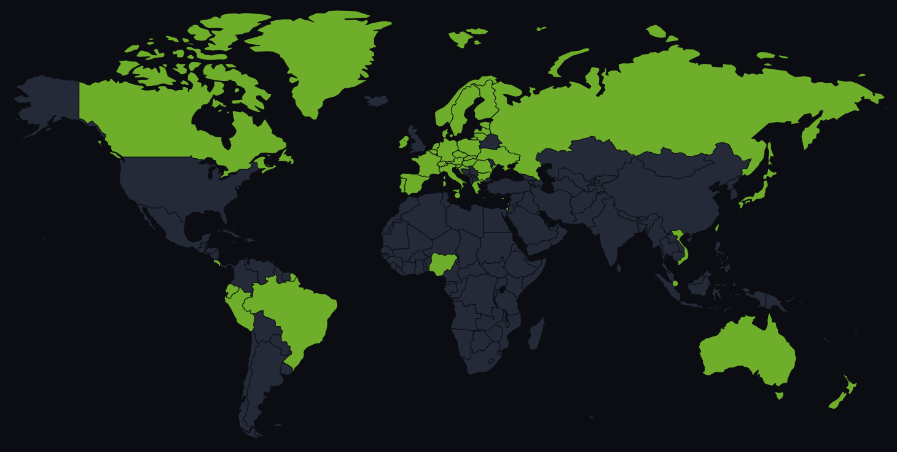

<div align="center">

# 🌍 Vatlas

**Give it a VAT number, get the company back.**

[vatlas.dev](https://vatlas.dev)

[](LICENSE)




<sub>Everything in green works today.</sub>

</div>

You have a tax number and you want to know who is behind it. Vatlas asks the official register of
the country and hands you back the name, national ID, legal form, status and address. No scraping,
no guessing.

```
GET /v1/lookup/FR95884831538
{
  "data": {
    "vatNumber": "FR95884831538", "countryCode": "FR", "nationalId": "884831538",
    "name": "...", "legalForm": "...", "status": "active",
    "address": { "line1": "...", "line2": null, "postalCode": "...", "city": "...", "country": "FR" }
  },
  "meta": { "source": "SIRENE", "sourceDate": "2026-01-05", "sourceUpdatedAt": "2026-01-05T10:00:00.000Z" }
}
```

Same thing for the whole EU and 18 other countries, each with its own funny format:
`PL5252248481`, `AU11000000948`, `JPT1010001001359`, `BR07396865000168`, `NO974760673MVA`.

## Features

- Full answers where VIES gives up. VIES often says "valid" with an empty name and address
  (Germany, Spain...). Vatlas asks the national registers too and keeps the most complete answer.
- Still works when VIES is down. Imported registers answer from the local database, and
  [async lookups](documentation/callbacks.md#async-lookups) retry a live register until it
  answers, then post the result to a webhook.
- [Monitors](documentation/callbacks.md#monitors): follow a customer or a supplier and get a
  signed webhook when its name, status or address changes.
- A [proof for your auditor](documentation/api.md#prefer): `?prefer=proof` returns the VIES
  consultation number, the one to keep next to your invoices.
- History: `?history` tells what a register said and when. Handy when a company moved or changed
  its name in the meantime.
- When registers disagree, [`/v1/lookup-all`](documentation/api.md#lookup-all) shows them side by
  side.
- Messy input is fine: `fr 95 884.831-538` works. Format and checksum are checked before any
  register is called.

## How it works

When a register publishes open data with a friendly licence, Vatlas imports all of it into MySQL
and answers from there. Otherwise it calls the register's public API live. And when an EU register
has nothing, VIES gets a chance.

The repository comes with the API (`src/server.ts`), a developer console for accounts, API keys,
usage and the audit trail (`src/consoleServer.ts`), and the public website (`site/`).

If it saved you a fight with VIES, a ⭐ is always appreciated.

## Install

Requirements: Node.js >= 20.11, MySQL >= 8.0, and Docker for the local stack (optional).

```bash
npm install
npm --prefix site install
cp .env.example .env        # defaults match the Docker stack
docker compose up -d        # MySQL, Adminer, Mailpit
npm run db:setup            # apply the Prisma migrations
```

VIES (the fallback for EU member states) is off in `.env.example`. To enable it, set
`VIES_REQUESTER_VAT` to your own VAT number and `VIES_ENABLED=true`. Some national registers need
an account. They are all optional, see [documentation/credentials.md](documentation/credentials.md).

## Usage

```bash
npm run dev                 # API on :3000, console on :3001, site on :5173
npm run import -- lv        # import one country's register (Latvia is the smallest)
curl localhost:3000/v1/demo/lookup/LV40003027238
```

Create an account in the console (<http://localhost:3001/signup>, emails land in Mailpit on
<http://localhost:8025>) to get an API key, then:

```bash
curl -H "Authorization: Bearer vtl_live_..." localhost:3000/v1/lookup/LV40003027238
```

Other useful commands:

```bash
npm test                    # unit tests, no network and no database
npm run lint                # ESLint
npm run format              # Prettier, rewrites files in place
npm run typecheck
npm run build               # compile to dist/
```

## Hosted or self-hosted

The easy way is [vatlas.dev](https://vatlas.dev) 🚀: create an account, grab an API key and you're
done. All the countries are there, the registers are imported and kept up to date for you.

You can also run Vatlas on your own server. You then handle the imports yourself, which is fine
if you only care about a few countries: import those, skip the rest. See
[Importing data](documentation/importing.md) and [Deployment](documentation/deployment.md).

## Documentation

- [Development](documentation/development.md): local stack, commands, project layout, tests
- [API](documentation/api.md): endpoints, parameters and errors
- [Monitors, async lookups and callbacks](documentation/callbacks.md)
- [Developer console](documentation/console.md): accounts, keys, personal data, plans, Stripe
- [Configuration](documentation/configuration.md): environment variables
- [Deployment](documentation/deployment.md): pm2, cron jobs, logs, disk sizing
- [Importing data](documentation/importing.md): bulk imports and history
- [Sources and countries](documentation/sources.md): adding a register or a country
- [Credentials](documentation/credentials.md): getting access to the registers that need an account
- [Benchmarking](documentation/benchmarking.md)
- [Website](documentation/site.md): the site and its translations

## License

This program is free software, under the [AGPLv3-or-later LICENSE](LICENSE).
